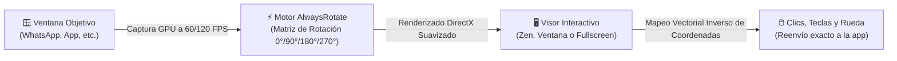

<div align="center">

  

  # 🔄 AlwaysRotate

  ### *Rotación dinámica en tiempo real (60 / 120 FPS) con reenvío matemático de clics para Windows y videollamadas de WhatsApp*

  [](https://github.com/RocamanMC/AlwaysRotate/releases/latest)
  [](https://microsoft.com)
  [](https://dotnet.microsoft.com/)
  [](https://github.com/RocamanMC/AlwaysRotate)
  [](LICENSE)
  [](https://github.com/RocamanMC/AlwaysRotate)
  [](https://rocaman.vercel.app/)

  <br/>

  ### 📥 Descargas Oficiales (Portable · Sin Instalador)

  [-10b981?style=for-the-badge&logo=windows)](https://github.com/RocamanMC/AlwaysRotate/releases/download/v3.4/AlwaysRotate.exe)
  &nbsp;
  [-6366f1?style=for-the-badge&logo=zip)](https://github.com/RocamanMC/AlwaysRotate/releases/download/v3.4/AlwaysRotate-v3.4-Portable.zip)
  &nbsp;
  [](https://github.com/RocamanMC/AlwaysRotate/releases)

  *100% autónomo y portable: no requiere instalación ni tener .NET previamente instalado en el sistema.*

</div>

---

## 📌 ¿Qué es AlwaysRotate?

**AlwaysRotate** es una utilidad de sistema ligera, ultra-rápida y de alto rendimiento diseñada para resolver de raíz el problema de las aplicaciones, transmisiones y videollamadas que se transmiten o abren en la orientación equivocada (vertical / apaisada) en monitores de PC.

A diferencia de software pesado de captura o soluciones virtuales con retardo, AlwaysRotate captura el búfer gráfico nativo de la ventana objetivo a **60 o 120 FPS**, le aplica rotación geométrica instantánea (**0°, 90°, 180°, 270°**) y transforma matemáticamente las coordenadas del ratón en tiempo real. Esto te permite **hacer clic, escribir, interactuar y hacer scroll con total precisión directamente sobre la imagen rotada**.



---

## ✨ Características Principales

| Función | Descripción |
| :--- | :--- |
| 🚀 **60 y 120 FPS Ultra-Fluidos** | Motor de renderizado con búfer de memoria optimizado para altas tasas de refresco, perfecto para monitores gaming y videollamadas sin stuttering. |
| 📞 **Detección Especial de WhatsApp** | Mapeo nativo de ventanas `ApplicationFrameHost` / `CoreWindow` de WhatsApp Desktop y videollamadas en tiempo real sin pantallas negras (captura directa por hardware). |
| 🖱️ **Interacción y Clics Matemáticos** | Conversión vectorial inversa de coordenadas. Puedes pulsar botones, escribir mensajes y usar la rueda del ratón directamente sobre el visor. |
| 👻 **Modo Fantasma (Ghost Window)** | Oculta la ventana original haciéndola **100% invisible** para eliminar duplicados en tu pantalla mientras sigues interactuando sobre AlwaysRotate. |
| 🖥️ **3 Modos de Visualización** | Alterna al instante entre modo normal, **Ventana Zen (F10)** (sin menús y redimensionable) y **Pantalla Completa (F11)** con barra flotante (HUD) auto-ocultable. |
| 🎨 **6 Temas de Color Modernos** | Paletas dinámicas en tiempo real: **Índigo** (clásico), **Esmeralda** (WhatsApp/Matrix), **Amatista** (Cyberpunk), **Carmesí** (Rubí), **Ámbar** (Dorado) y **Glaciar** (Cyan). |
| 🔍 **3 Algoritmos de Escalado** | Elige entre **Alta** (suavizado bicúbico continuo), **Bilineal** (ahorro de recursos/batería) y **Nítida** (píxel puro 1:1 Nearest Neighbor para texto y código). |
| ⌨️ **Atajos 100% Reconfigurables** | Personaliza cada atajo de teclado global directamente desde la pestaña de Ajustes con escucha interactiva de teclas. |
| 📦 **100% Portable** | Guarda tu última configuración, ventana, tamaño y rotación en `config.json`, con interruptor opcional para arrancar junto con Windows. |

---

## ⌨️ Atajos de Teclado Globales

Puedes controlar AlwaysRotate en cualquier instante mediante atajos de teclado globales:

| Atajo por Defecto | Acción |
| :---: | :--- |
| <kbd>Esc</kbd> | Salir de Pantalla Completa o Modo Solo Ventana / Cerrar panel de ajustes |
| <kbd>F10</kbd> | Alternar **Modo Solo Ventana** (sin menús, marco nativo redimensionable) |
| <kbd>F11</kbd> | Alternar **Pantalla Completa** total en el monitor |
| <kbd>Ctrl</kbd> + <kbd>Alt</kbd> + <kbd>R</kbd> | Capturar y rotar automáticamente la ventana que tengas activa en Windows |
| <kbd>Ctrl</kbd> + <kbd>Alt</kbd> + <kbd>G</kbd> | Alternar **Modo Fantasma** (ocultar / mostrar ventana original) |
| <kbd>Ctrl</kbd> + <kbd>Alt</kbd> + <kbd>→</kbd> / <kbd>Espacio</kbd> | Girar **+90°** al vuelo |
| <kbd>Ctrl</kbd> + <kbd>Alt</kbd> + <kbd>P</kbd> | Alternar **Fijo** (Always on Top / Siempre encima de otras ventanas) |
| <kbd>Ctrl</kbd> + <kbd>Alt</kbd> + <kbd>I</kbd> | Alternar reenvío de clics del ratón (Modo interactivo / Solo visor) |
| <kbd>Alt</kbd> + Clic Arrastre | Mover la ventana libremente arrastrando desde cualquier parte del visor |

> [!NOTE]
> Puedes redefinir cualquiera de estos atajos en cualquier momento desde el menú **Ajustes ⚙️ > Atajos de Teclado**.

---

## 🎨 Modos de Calidad y Escalado

En el panel de **Ajustes** puedes seleccionar y hacer clic sobre cualquier algoritmo para adaptar el renderizado al contenido:

* **🔹 Alta (Bicúbica / Fant)**: Muestreo continuo que suaviza diagonales, curvas y elimina dientes de sierra.  
  👉 *Recomendado para: Videollamadas, cámaras web, streaming y vídeos.*
* **🔸 Bilineal**: Interpolación rápida con el mínimo impacto en recursos de GPU y batería.  
  👉 *Recomendado para: Equipos portátiles o PCs con hardware modesto.*
* **🟢 Nítida (Píxel Puro / Nearest Neighbor)**: Mapeo exacto 1:1 sin difuminado ni filtros gaussianos.  
  👉 *Recomendado para: Lectura de textos pequeños, terminales, código fuente, emuladores y pixel art.*

---

## 🚀 Inicio Rápido

1. Descarga el ejecutable desde [Releases](https://github.com/RocamanMC/AlwaysRotate/releases/latest) o ejecuta:
   ```text
   AlwaysRotate.exe
   ```
2. **Selecciona la ventana**: AlwaysRotate detecta automáticamente si WhatsApp o una videollamada está activa y la selecciona en primer lugar. También puedes elegir cualquier otra ventana desde el desplegable superior.
3. **Elige la rotación**: Pulsa `0°`, `90°`, `180°` o `270°`.
4. **Interactúa**: Tus clics y la rueda del ratón funcionarán en tiempo real sobre la ventana como si fuera nativa.

> [!TIP]
> Si deseas que AlwaysRotate se abra automáticamente al iniciar sesión en tu PC, ve al botón **Ayuda / Ajustes** y activa el interruptor **"Iniciar con Windows"**.

---

## 🏗️ Compilación desde el Código Fuente

Si prefieres compilar la aplicación tú mismo desde el código fuente, requiere el SDK de .NET 10:

```powershell
# 1. Clonar el repositorio
git clone https://github.com/RocamanMC/AlwaysRotate.git
cd AlwaysRotate

# 2. Compilar binario single-file autónomo
dotnet publish AlwaysRotate/AlwaysRotate.csproj -c Release -r win-x64 --self-contained -p:PublishSingleFile=true -o dist/
```

El ejecutable resultante en `dist/AlwaysRotate.exe` será 100% autónomo y portable.

---

## 🛠️ Tecnologías Utilizadas

- **Lenguaje**: C# 13 / .NET 10.0 (Windows Desktop)
- **Framework de Presentación**: Windows Presentation Foundation (WPF) con renderizado `Display` / `ClearType` y aceleración DirectX
- **Win32 Interop**: `user32.dll`, `gdi32.dll`, `dwmapi.dll`, Hooks de teclado de bajo nivel (`WH_KEYBOARD_LL`), Hotkeys globales y `SetWindowDisplayAffinity`
- **Formato**: Aplicación 100% portable y autónoma

---

## 📄 Licencia

Este proyecto está bajo la Licencia **MIT**. Consulta el archivo [LICENSE](LICENSE) para más detalles.

---

## 👨‍💻 Autor

Desarrollado por **Rocaman**  
🌐 Web Oficial: [rocaman.vercel.app](https://rocaman.vercel.app/)  
📦 Tienda de Aplicaciones: [RocaStore](https://rocastore.vercel.app/)

---

<div align="center">
<sub>AlwaysRotate forma parte del ecosistema oficial de utilidades de sistema de Rocaman.</sub>
</div>
